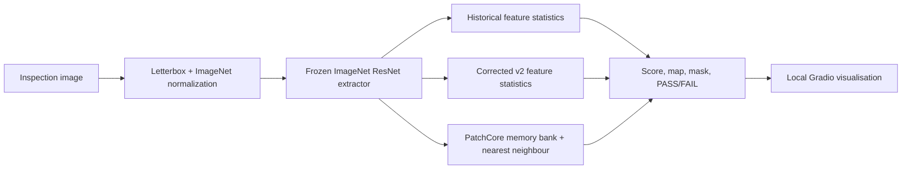

# ForgeSight — Industrial Visual Anomaly Detection

ForgeSight is a reproducible **research prototype** for one-class industrial
visual anomaly detection. Given normal reference images, it produces an image
anomaly score, a pixel-level anomaly map, a predicted mask, and a PASS/FAIL
decision. It is not production-qualified and must not be used as the sole
quality-control decision system.

## Scope and status

The project supports local PyTorch/CUDA inference and a localhost-only Gradio
demo. Docker is the primary deployment prototype. The image does not contain
datasets or detector artifacts: operators mount trusted artifacts read-only.



## Detector families

| Family | Core method | Validated artifact scope |
| --- | --- | --- |
| Historical feature statistics | Original multi-layer ResNet feature statistics and historical threshold/mask semantics. | Historical ResNet-18/34/50/101/152 artifacts when compatible pretrained weights are available. |
| Corrected feature statistics v2 | Explicit `feature_statistics_v2_unweighted_layer_stats` methodology with checked preprocessing and provenance. | ResNet-50; completed exploratory MVTec artifacts. |
| PatchCore | Frozen ImageNet ResNet features, deterministic normal-only patch-memory coreset, chunked nearest-neighbour anomaly maps. | ResNet-18; completed exploratory MVTec artifacts. |

The families have different backbones, fitting procedures, score scales, and
threshold semantics. Their raw scores are not comparable across families.

## Data and experimental protocol

Fitting is normal-only. ForgeSight separates normal fitting and calibration
images, then applies frozen artifacts and thresholds at evaluation. Optional
mixed good/defect calibration is a separate, prespecified development-data
protocol; it must never move examined MVTec or VisA final images into a new
development set.

MVTec AD and VisA are not distributed with this repository. Their licences,
terms, and any commercial-use restrictions remain the operator’s responsibility.
Keep raw data, checkpoints, memory banks, evaluation reports, and generated
outputs outside Git.

## Verified benchmark evidence

These outcomes are exploratory research evidence, not model-selection or
production claims.

| Dataset / method | Image AUROC | Pixel AUROC | Notes |
| --- | ---: | ---: | --- |
| MVTec AD, corrected v2 ResNet-50 macro over 15 categories | 0.948426 | 0.919948 | Does not meet the 0.95 all-category targets. |
| MVTec AD, PatchCore ResNet-18 macro over 15 categories | 0.896620 | 0.889385 | Does not meet the 0.95 all-category targets. |
| VisA capsules, frozen PatchCore external transfer | 0.635550 | Not release-valid | FNR 41/51; normal-only q98-higher threshold `0.9470425248146057`. |

VisA external transfer was poor. Historical VisA sealed-final pixel metrics are
alignment-limited because the first evaluator square-resized non-square masks
while inference letterboxed images. The sealed final was not rerun. See
[production readiness](docs/PRODUCTION_READINESS.md) and the
[VisA development-only analysis](docs/VISA_CAPSULES_DEVELOPMENT_FAILURE_ANALYSIS.md).
No production qualification is claimed.

## Repository layout

```text
forgesight_ad/       Detector adapters, scoring pipelines, safety checks
tools/               Reproducible fitting, validation, deployment utilities
tests/               Synthetic/unit regression tests (no datasets or GPU required)
configs/             Runtime and experiment configuration templates
docs/                Methodology, deployment, evidence, and release records
Dockerfile           Native PyTorch/CUDA runtime image
compose.yaml         Localhost-only GPU deployment
```

## Native development (Windows or Linux)

Requirements: CPython 3.10–3.12. The verified Windows environment uses Python
3.12, PyTorch 2.5.1+cu124, TorchVision 0.20.1+cu124, and an RTX 3060.

```powershell
python -m venv .venv
.\.venv\Scripts\Activate.ps1
python -m pip install --upgrade pip
python -m pip install -r requirements-dev.txt
python -m pytest --basetemp .\validation_runs\pytest_local -q
python -m pip check
```

Tests use synthetic tensors and mocks. They do not train models, require a
dataset, or prove CUDA/browser performance.

## Docker GPU deployment

Docker uses `pytorch/pytorch:2.5.1-cuda12.4-cudnn9-runtime`, a Linux CPython
3.11 hashed wheelhouse, and read-only artifact mounts. Docker Desktop with the
WSL2 backend and an NVIDIA driver with WSL CUDA support are required.

```powershell
# First prepare the offline wheelhouse and trusted TorchVision cache as documented.
.\.venv\Scripts\python.exe .\tools\build_linux_wheelhouse.py --download
docker compose up --build
```

Open `http://127.0.0.1:7860`. Compose publishes only to host loopback and the
application always uses `share=False`. The service never trains, calibrates,
writes artifacts, or silently downloads pretrained weights. Missing cached
weights fail clearly.

The registry can discover 105 artifact configurations, but hermetic execution
requires the corresponding pretrained ResNet weight. The currently smoke-tested
cache-supported configurations are historical ResNet-18, corrected-v2
ResNet-50, and PatchCore ResNet-18. See
[Docker deployment](docs/DOCKER_DEPLOYMENT.md) and the
[release smoke test](docs/RESEARCH_PROTOTYPE_V1_RELEASE_SMOKE_TEST.md).

For CPU-only functional fallback:

```powershell
docker compose -f compose.cpu.yaml up --build
```

## Local inference demo

Mount or configure trusted artifact roots, then run:

```powershell
$env:FORGESIGHT_ARTIFACTS_ROOT = 'C:\path\to\historical_artifacts'
$env:FORGESIGHT_DEVICE = 'cuda:0' # or cpu
.\.venv\Scripts\python.exe .\demo_app.py
```

The demo validates artifact methodology, backbone, category, preprocessing,
and device compatibility before inference. It returns input, heatmap overlay,
mask overlay, and JSON prediction metadata.

## Reproducibility

- `requirements.txt` pins the native runtime stack.
- `requirements-docker.lock.txt` pins and hashes the non-PyTorch Linux Docker
  dependency closure; PyTorch/TorchVision/CUDA come from the pinned base image.
- `configs/defaults.json` records supported Python, preprocessing, seed, paths,
  and security defaults.
- Evaluation artifacts record configuration, provenance, environment, and
  checkpoint hashes. Historical artifacts and results are immutable inputs.

Read [RESEARCH_PROTOTYPE_V1_RELEASE_READINESS.md](docs/RESEARCH_PROTOTYPE_V1_RELEASE_READINESS.md)
before interpreting results or preparing a release.

## Limitations and future work

- Accuracy, FPR, and FNR targets are unmet overall.
- Independent industrial validation, valid final pixel-localization evidence,
  HTTP/browser latency, concurrency/soak testing, artifact signing, and SBOM/
  vulnerability review remain outstanding.
- ONNX/OpenVINO is optional future work; native PyTorch/CUDA Docker is the
  validated deployment prototype.

## Licence and citation

Code is licensed under [MIT](LICENSE). Dataset and pretrained-weight licences
are separate. Cite using [CITATION.cff](CITATION.cff). The citation repository
URL is verified from the configured Git remote; release-date metadata remains
intentionally unset until a release is authorised.
